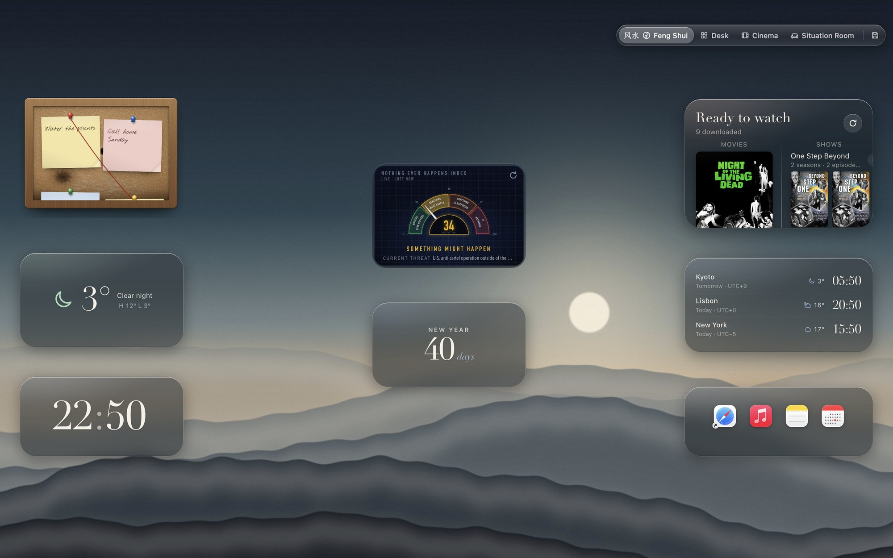
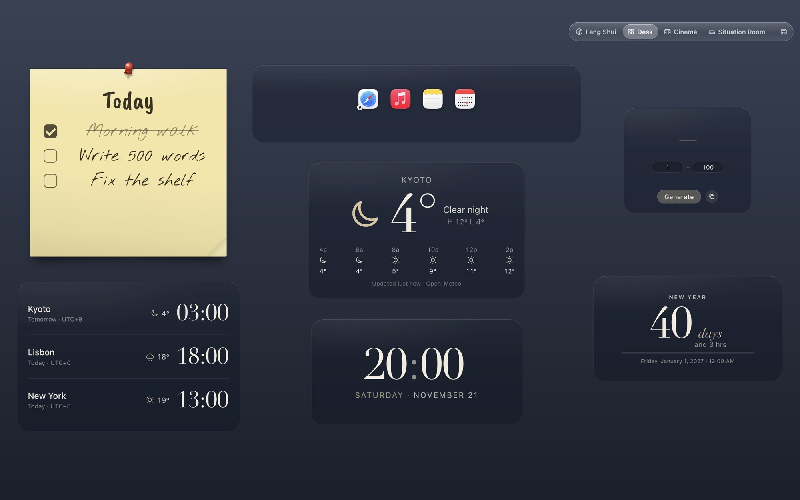
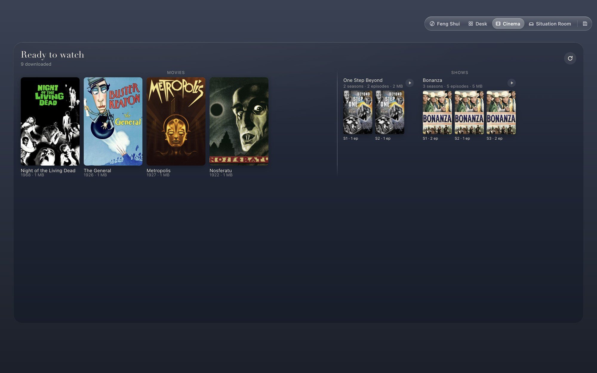

<h3 align="center">jonacloud8765</h3>

a small software studio · quiet tools for the Mac

 

### 一 · Introduction

I make small desktop software: things that sit beside your work and stay out
of its way. Most of it starts as something I wanted on my own Mac.

### 二 · Philosophy

- **Calm first.** A tool should lower the noise on the screen, not add to it.
- **Balance over features.** Fewer options, chosen well, and placed with care.
- **Honest data.** If something can't be fetched, say so. Never make it up.
- **Yours to keep.** Open source, no accounts, no tracking, files you can read.

### 三 · Featured: Feng Shui (aka Morrow)

**[Feng Shui](https://github.com/jonacloud8765/morrow)** is a set of calm desktop
widgets for macOS. Each widget is a window of its own: clocks, weather, world
clocks, films, sticky notes, a corkboard, a whiteboard and a few small toys.
Layouts keep different arrangements, and the Feng Shui layout places everything
on a bagua grid so the desktop feels balanced.

<table>
  <tr>
    <td width="50%"></td>
    <td width="50%"></td>
  </tr>
  <tr>
    <td>Glass widgets with real macOS blur.</td>
    <td>Films, with each show's seasons gathered together.</td>
  </tr>
</table>

Screenshots are from the running app with demo data.

- Electron with a small native AppKit helper for real blur and desktop-level windows
- One shared liquid glass, arranged on a bagua grid and balanced by element
- Keep Mac Awake from the menu bar, arrow-key layout switching, and Films that groups shows by season
- MIT licence

**NF Widget** is one of its widgets: a green briefcase that opens a small,
harmless 90s-style launch screen. It's a joke, and it makes no requests of any kind.

### 四 · Other projects

Other work is still private. It will show up here once it's ready to share.

### 五 · Technologies

Used in the public work above:

`JavaScript` · `HTML` · `CSS` · `Electron` · `Node.js` · `Objective-C++ / AppKit` · `Shell`

### 六 · What I'm building

More of Feng Shui: steadier layouts, better Films, and widgets that earn
their place on the desktop.

 

Leave space. Let things breathe. 留白

